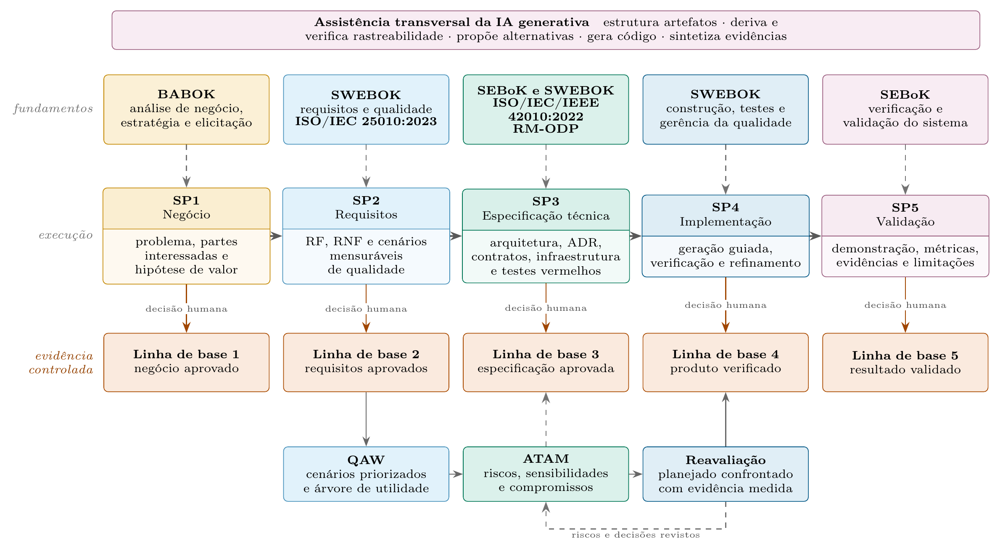

# DAIA-E

**Desenvolvimento Assistido por Inteligência Artificial Orientado por Especificação.**

Validador de descrição arquitetural e processo guiado para construir software com
assistentes de IA. O DAIA-E conduz o projeto do negócio à validação, verifica
pelo CLI cada artefato, referência, teste e evidência, e só encerra cada etapa com
uma decisão humana registrada.

O kernel não chama modelos de linguagem. Os agentes e as skills orientam o
assistente do host (Claude, Codex ou outro); o CLI verifica o resultado.

## O método



*Fluxo do método DAIA-E. As setas tracejadas indicam sustentação metodológica.*

O desenvolvimento passa por cinco sprints. Cada sprint delimita **escopo, não
duração**, se apoia num corpo de conhecimento e termina numa **linha de base**
(baseline): o estado aprovado do projeto naquele ponto. Uma linha de base só se
fecha por decisão humana registrada, e a sprint seguinte só começa depois dela.

| Sprint | Fundamento | O que produz | Linha de base |
|---|---|---|---|
| SP1 — Negócio | BABOK | problema, partes interessadas, direcionadores de negócio e hipótese de valor, com personas, processos BPMN e IDEF0 | 1 — negócio aprovado |
| SP2 — Requisitos | SWEBOK e ISO/IEC 25010:2023 | RF, RNF e cenários mensuráveis de qualidade | 2 — requisitos aprovados |
| SP3 — Especificação técnica | SEBoK, SWEBOK, ISO/IEC/IEEE 42010:2022 e RM-ODP | arquitetura, decisões (ADR), contratos, infraestrutura e testes vermelhos | 3 — especificação aprovada |
| SP4 — Implementação | SWEBOK | geração guiada, verificação e refinamento até os testes ficarem verdes | 4 — produto verificado |
| SP5 — Validação | SEBoK | demonstração, métricas, evidências e limitações | 5 — resultado validado |

A avaliação arquitetural atravessa as sprints em ciclo. Depois da linha de base
2, o **QAW** prioriza os cenários de qualidade numa árvore de utilidade; o
**ATAM** examina riscos, sensibilidades e compromissos antes da linha de base 3;
e, durante a implementação, a **reavaliação** confronta o planejado com a
evidência medida antes da linha de base 4, devolvendo ao ATAM os riscos e as
decisões revistos.

A IA generativa assiste **todas** as sprints: estrutura artefatos, deriva e
verifica rastreabilidade, propõe alternativas, gera código e sintetiza
evidências. O que preserva o caráter deliberado das decisões não é restringir a
IA a uma etapa, e sim a decisão humana no fechamento de cada linha de base.

No CLI, a linha de base é a `baseline`: `daia baseline sign` registra quem
decidiu, quando, com que justificativa e sobre qual estado do modelo (um hash
do conteúdo de todos os artefatos).

Princípios que o CLI faz valer (detalhes na [constituição](.daia-core/constitution.md)):

- **Decisão humana** (Art. II): agentes redigem tudo, mas nenhuma baseline fecha sem aprovação registrada.
- **Ordem das baselines** (Art. III): nada de uma sprint é produzido antes de a anterior fechar.
- **Rastreabilidade** (Art. IV): todo artefato deriva de um anterior; invenção é detectável.
- **Qualidade como cenário** (Art. V): todo requisito não funcional tem medida e teste.
- **Descrição arquitetural** (Art. VII): views segundo a ISO/IEC/IEEE 42010:2022.
- **Especificação antes da geração** (Art. VIII): nenhum código de produto antes da SP3.
- **Alternativa registrada** (Art. IX): toda decisão relevante registra o que foi preterido e por quê.
- **Corpos de conhecimento** (Art. X): BABOK, SWEBOK e SEBoK ancoram cada sprint.

## Começar

Requer Node.js 18 ou superior. Não há dependências externas nem clone.

```bash
npx github:afonsolelis/daia-e-core init meu-projeto
cd meu-projeto
npx github:afonsolelis/daia-e-core next
```

Para usar só `daia` nos comandos, instale uma vez:

```bash
npm install -g github:afonsolelis/daia-e-core
daia init meu-projeto
```

A instalação é recomendada: o assistente de IA também roda `daia next`,
`daia gate` e `daia verify` dentro do projeto. O restante deste README usa
`daia`; sem instalar, troque por `npx github:afonsolelis/daia-e-core`.

Em terminal interativo, o onboarding pergunta nome, se o projeto é novo ou
existente, objetivo, stack, restrições e runtime. Para automação, passe tudo por flag:

```bash
daia init meu-projeto --yes --mode new --runtime codex \
  --name "Meu projeto" --objective "Objetivo do sistema" \
  --stack "a definir" --constraints "a definir" --catalog rm-odp
daia next --root meu-projeto
```

| Flag | Valores | Padrão |
|---|---|---|
| `--mode` | `new`, `existing` | `new` |
| `--runtime` | `codex`, `claude`, `portable` | `codex` |
| `--catalog` | `rm-odp`, `4plus1`, `c4` | `rm-odp` |

O `init` cria `.daia/` no projeto: configuração, guia, schemas, modelo, histórico
do workflow, agentes de referência e skills no runtime escolhido. Os demais
comandos operam no diretório atual ou no indicado por `--root`.

## Tutorial: do zero à SP1 assinada

Um sistema de empréstimos para uma biblioteca escolar, do `init` à primeira
baseline. O resultado final deste tutorial está em `examples/primeiro-projeto/`.

### 1. Criar o projeto

```bash
npm install -g github:afonsolelis/daia-e-core
daia init biblioteca --yes --runtime claude \
  --name "Biblioteca escolar" \
  --objective "Reduzir os atrasos de devolução dos livros"
cd biblioteca
daia next
```

O `daia next` mostra a SP1 e os bloqueios iniciais, porque o modelo está vazio:

```text
SP1 — Contexto, personas e processos
Skills: model-business-context, model-business-processes, validate-business-layer
Entregas: BusinessDriver, Stakeholder, Concern, Persona, BusinessProcess (BPMN), Idef0Activity

x SP1-FOUNDATION (Art. X)
   SP1 nenhum direcionador de negocio declarado
   SP1 nenhuma parte interessada declarada
x BIZ-PERSONA (Art. X)
   SP1 nenhuma persona declarada
...
```

### 2. Pedir os artefatos ao assistente

Abra o assistente na pasta do projeto (`claude` para o Claude Code, `codex` para
o Codex) e descreva o problema. Um pedido que funciona:

> Rode `daia next --json`, leia `.daia/guide.md` e `.daia/agents/analyst.md` e
> use a skill `model-business-context` e depois a `model-business-processes`.
> O problema: a biblioteca da escola controla empréstimos num caderno e cerca de
> 30% dos livros voltam atrasados. Quem sofre é a bibliotecária, que atende uns
> 40 alunos por dia, e a coordenação, que responde pelo acervo. Pergunte o que
> você não souber em vez de inventar. Ao final, rode `daia gate SP1`.

No Claude Code, as skills também podem ser chamadas pelo nome, como
`/model-business-context`. O assistente grava um JSON por artefato em
`.daia/model/`. Um direcionador, por exemplo:

```json
{
  "id": "BD-devolucao",
  "kind": "BusinessDriver",
  "statement": "Reduzir os atrasos de devolução do acervo escolar",
  "rationale": "Na conferência do último semestre, cerca de 30% dos empréstimos voltaram depois do prazo",
  "stakeholders": ["STK-bibliotecaria", "STK-coordenacao"],
  "idef0_node": "A0",
  "hypothesis": "Registrar o prazo no empréstimo e avisar o aluno antes do vencimento reduz os atrasos para menos de 10%",
  "sprint": "SP1",
  "provenance": { "drafted_by": "ai-assisted" }
}
```

O conjunto mínimo da SP1 tem oito artefatos e um BPMN: duas partes
interessadas, uma preocupação, um direcionador com hipótese, uma persona com
evidência, a atividade IDEF0 `A0`, um processo e a view enterprise, mais
`docs/emprestar-livro.bpmn`. Para ver todos sem usar o assistente:

```bash
npx degit afonsolelis/daia-e-core/examples/primeiro-projeto/.daia/model .daia/model --force
npx degit afonsolelis/daia-e-core/examples/primeiro-projeto/docs docs
```

### 3. Passar no gate

```bash
daia gate SP1
```

Cada bloqueio diz o que falta e qual regra exige. Um erro comum: a raia do BPMN
precisa ter o nome exato da persona, com acento.

```text
x BIZ-BPMN (Art. X)
   BP-emprestar-livro persona "Bibliotecária" sem raia (lane) no BPMN
   Nomeie a lane ou o participant com o nome da persona.
```

Com tudo certo:

```text
11 regras | 8 artefatos | 0 bloqueio(s) | 0 alerta(s) | 0 informativo(s)

PASSOU — o gate nao encerra a baseline. Art. II exige assinatura humana:
  daia baseline sign SP1 --by "<nome>" --rationale "<razao>"
```

Registre a verificação com `daia verify SP1`. O `daia status` passa a mostrar a
SP1 como "pronta para assinar".

### 4. Aprovar a baseline

A assinatura é sua, não do assistente. Revise os artefatos e, se concordar:

```bash
daia baseline sign SP1 --by "Seu nome" --rationale "Modelo de negócio revisado com a bibliotecária"
```

A SP1 fica "assinada" e o `daia next` avança para a SP2, já apontando o
primeiro bloqueio:

```text
SP2 — Requisitos e qualidade
x ELI-ACTIVITY-COVERAGE (Art. X)
   IDF-A0 atividade A0 "Gerir empréstimos do acervo" dentro da fronteira sem requisito funcional
```

Se você alterar um artefato da SP1 depois de assinar, o `daia status` mostra
"revisão necessária". Desfazer a alteração restaura o estado assinado; mantê-la
exige nova aprovação.

### 5. As sprints seguintes

O ciclo se repete: `daia next`, pedido ao assistente, `daia gate`, `daia verify`
e a sua assinatura.

| Sprint | Peça ao assistente | O gate cobra |
|---|---|---|
| SP2 | "Siga `@po` e as skills `elicit-requirements-from-business` e `specify-quality-scenarios`." | requisito para cada atividade dentro da fronteira, cenários de qualidade com medida real |
| SP3 | "Siga `@arch`, depois `@test`; avalie as táticas com `@atam`." | modelos estático e dinâmico, views, decisões com alternativa, contratos de teste em vermelho |
| SP4 | "Siga `@dev` e implemente a especificação assinada." | contratos verdes com evidência atual e `quality-report.md` |
| SP5 | "Siga `@val` e confronte a hipótese." | `validation.md` com roteiro, resultados e limitações |

A partir da SP3, configure em `.daia/config.json` o comando de cada contrato de
teste (veja [Evidências executáveis](#evidências-executáveis)).

## Fluxo de trabalho

A cada passo:

1. `daia next` mostra a etapa atual, as entradas, as entregas, as skills e os bloqueios.
2. O assistente produz os artefatos em `.daia/model/`, seguindo `.daia/guide.md` e os schemas em `.daia/schemas/`.
3. `daia gate SP<n>` inspeciona as regras, sem executar comandos do projeto.
4. `daia verify SP<n>` executa os testes configurados e registra o progresso em `.daia/workflow.json`.
5. O humano aprova: `daia baseline sign SP<n> --by "Nome" --rationale "Justificativa"`.

| Sprint | Agentes | Skills |
|---|---|---|
| SP1 | `@analyst`, `@pm`, `@ux-design-expert`, `@val-neg` | model-business-context, model-business-processes, validate-business-layer |
| SP2 | `@po`, `@pm`, `@qaw`, `@ux-design-expert`, `@val-req` | elicit-requirements-from-business, specify-quality-scenarios, prioritize-architecture-drivers, validate-requirements-layer |
| SP3 | `@arch`, `@data-engineer`, `@atam`, `@spec`, `@test`, `@qa`, `@val-eng`, `@val-tec` | describe-software-architecture, validate-engineering-layer, validate-technology-layer, evaluate-architecture-tradeoffs, write-executable-specification e as sete skills de táticas (abaixo) |
| SP4 | `@dev`, `@data-engineer`, `@qa`, `@audit`, `@devops` | implement-from-baseline, validate-system-evidence |
| SP5 | `@val`, `@devops`, `@qa` | validate-system-evidence |

Transversais: `@rec` conduz o encerramento das baselines, `@sm` remove
impedimentos, `@daia-master` encaminha pedidos e corrige o curso, e
`@squad-creator` cria agentes e skills.

**Táticas arquiteturais.** Na SP3 e na reavaliação da SP4, o `@atam` avalia as
decisões contra as táticas de Bass, Clements e Kazman (*Software Architecture in
Practice*, 3ª ed., caps. 5–11), uma skill por atributo:
`evaluate-availability-tactics`, `evaluate-interoperability-tactics`,
`evaluate-modifiability-tactics`, `evaluate-performance-tactics`,
`evaluate-security-tactics`, `evaluate-testability-tactics` e
`evaluate-usability-tactics`. As táticas aplicadas ficam no campo `tactics` de
cada decisão, como `availability/active-redundancy`.

**Validadores de camada.** Cada camada recebe parecer antes da seguinte:
`@val-neg` (negócio, BABOK), `@val-req` (elicitação, SWEBOK + SEBoK), `@val-eng`
(engenharia, SEBoK + RM-ODP) e `@val-tec` (tecnologia). As regras mecânicas
correspondentes aparecem no gate com os prefixos `BIZ-`, `ELI-`, `ENG-` e `TEC-`.

### Software existente

Use `--mode existing`. Comece pelo inventário de código e testes em
`.daia/evidence/recovery.md`, com origem e limitações. Views recuperadas exigem
confirmação declarada após revisão humana. Testes já existentes podem
permanecer verdes na SP3.

## Comandos

| Comando | O que faz |
|---|---|
| `init [dir]` | Onboarding e criação de `.daia/` |
| `next [--json]` | Etapa atual, entradas, entregas, skills e bloqueios |
| `gate [SP1..SP5] [--json] [--quiet]` | Avalia as regras; sai com código diferente de zero quando há bloqueio |
| `verify [SP1..SP5]` | Executa os testes configurados e registra o progresso |
| `validate architecture` | Gate da SP3, incluindo evidências e pré-requisitos |
| `status` | Estado das cinco sprints e das baselines, atuais ou desatualizadas |
| `baseline list` | Lista as baselines e verifica as assinaturas |
| `baseline sign <SP> --by <nome> --rationale <razão> [--debt "a;b"] [--force]` | Encerra a baseline com decisão humana registrada |
| `trace <id> [--up]` | Cadeia de rastreabilidade a partir de um artefato |
| `trace --matrix` | Matriz requisito → cenário → teste |
| `impact <id>` | O que é afetado por uma mudança no artefato |
| `viewpoints [--catalogs]` | Catálogo de viewpoints ativo, ou os disponíveis |
| `rules` | Regras de correspondência e os artigos que as sustentam |
| `squad` | Lista os agentes e verifica o contrato de portabilidade |
| `skills` | Lista as skills |
| `skills sync [id] --to <runtime>` | Instala uma ou todas as skills no runtime |
| `setup --to <runtime>` | Instala agentes e skills no runtime do projeto |
| `doctor` | Diagnóstico do ambiente e do modelo |

## Agentes

A squad tem 23 agentes em `squads/daia-e/agents/`, cada um com sprint, views,
corpo de conhecimento, fronteira explícita e skills. Qualquer agente funciona
colado num chat, sem depender de runtime (Art. XI).

Os 12 agentes do aiox-core têm correspondente, adaptado à constituição do DAIA-E.
O mapa fica em `lineage`, no `squad.json`:

| aiox-core | DAIA-E | Adaptação principal |
|---|---|---|
| `@aiox-master` | `@daia-master` | encaminha por sprint e corrige o curso; não executa trabalho especializado |
| `@analyst` | `@analyst` | pesquisa e brainstorming alimentam a SP1 |
| `@architect` | `@arch` | decisões em views ISO 42010, com alternativa registrada |
| `@data-engineer` | `@data-engineer` | detalha a view information; a tecnologia de banco é de `@arch` |
| `@dev` | `@dev` | implementa a especificação assinada da SP3, não stories |
| `@devops` | `@devops` | sem autoridade exclusiva: o humano confirma cada operação irreversível |
| `@pm` | `@pm` | visão, escopo e priorização MoSCoW, sem PRD nem épicos |
| `@po` | `@po` | engenharia de requisitos com `priority` decidida pelo humano |
| `@qa` | `@qa` | parecer consultivo; dispensa vira dívida aceita pelo humano |
| `@sm` | `@sm` | facilita entre baselines, sem prazo fixo nem backlog |
| `@squad-creator` | `@squad-creator` | cria agentes e skills pelos contratos do DAIA-E |
| `@ux-design-expert` | `@ux-design-expert` | pesquisa, interação e WCAG AA ligados às personas |

Os demais agentes são próprios do método: `@qaw`, `@atam`, `@spec`, `@test`,
`@audit`, `@val`, `@rec` e os quatro validadores de camada.

## O que é validado

- Schemas e referências entre tipos de artefato.
- Cobertura de concerns por views, modelos estáticos e dinâmicos, e alternativas registradas.
- Existência de documentos e testes referenciados; referências fora do projeto são recusadas.
- Correspondências declaradas com origem, destino e justificativa.
- Execuções registradas dos testes e fingerprints dos arquivos declarados.
- Ordem das baselines e mudanças em documentos, testes e implementação declarada.

O resultado é validação estrutural e de evidências, **não certificação ISO**.
A coerência semântica dos diagramas, a adequação das decisões, os tradeoffs e o
significado das medidas exigem revisão humana. Restrições de código podem ser
verificadas por testes de arquitetura registrados como contratos.

## Evidências executáveis

Em `.daia/config.json`, configure a verificação por contrato:

```json
{
  "verification": {
    "TC-exemplo": {
      "command": "node",
      "args": ["--test", "tests/exemplo.test.js"],
      "inputs": ["src/exemplo.js", "package.json"]
    }
  }
}
```

`daia verify SP3` executa os comandos configurados sem shell, com timeout de 60
segundos por contrato, e registra a saída, o código de saída e o fingerprint. O
teste e o modelo entram automaticamente no fingerprint; declare em `inputs` todos
os demais arquivos relevantes. Serviços externos, variáveis de ambiente e
arquivos omitidos não são cobertos. Execute apenas comandos de projetos em que confia.

O gate não aceita apenas `phase: green`: exige evidência compatível e atual.
Uma falha em vermelho precisa ser inspecionada, para distinguir comportamento
ainda não implementado de defeito no teste. O sistema não altera `phase` sozinho.

A SP4 exige `quality-report.md`, e a SP5 exige também `validation.md`, ambos em
`.daia/evidence/`, com resultados e limitações. O CLI verifica a presença dos
relatórios; a qualidade das conclusões depende da revisão.

## Aprovações e mudanças

A baseline registra nome, justificativa, data e hash do estado do modelo. É uma
**aprovação local declarada**, não autenticação de identidade nem assinatura
criptográfica. Agentes só a registram após autorização explícita da pessoa.

Mudanças nos artefatos referenciados invalidam a baseline correspondente, que
passa a aparecer como "revisão necessária" em `daia status`. Na SP4 e na SP5,
os arquivos de implementação declarados em `inputs` e os relatórios também
entram no cálculo. Baselines assinadas antes de o cálculo incluir o conteúdo dos
arquivos aparecem igualmente como "revisão necessária" e precisam ser revistas.

`--debt` registra a aceitação com dívida. `--force` permite assinar com bloqueio
pendente, mas não transforma evidência ausente em comprovação: o fluxo continua
mostrando os bloqueios não resolvidos.

## Runtimes

```bash
daia setup --to codex
daia setup --to claude
daia setup --to portable
daia skills sync describe-software-architecture --to codex
```

| Runtime | Destino das skills | Documentação |
|---|---|---|
| `claude` | `.claude/skills/` | [Claude Code](https://code.claude.com/docs/en/skills) |
| `codex` | `.agents/skills/` | [Codex](https://learn.chatgpt.com/docs/build-skills) |
| `portable` | `.daia/export/skills/` | integração manual em outros hosts |

Os 23 agentes são instalados como material de referência em `.daia/agents/`;
não são registrados como subagentes nativos do runtime. Não há promessa de
ativação automática em hosts não testados.

A instalação valida a biblioteca antes de gravar, é idempotente e recusa
conflitos com conteúdo diferente. Preserve ou mova customizações antes de
reinstalar. Projeções antigas em `.codex/skills/` não são apagadas
automaticamente; revise-as para evitar duplicação.

## Exemplos

`examples/primeiro-projeto/` é o resultado do tutorial: a SP1 completa da
biblioteca escolar, sem baseline assinada. Um teste garante que ele continua
passando no `gate SP1`.

```bash
npx degit afonsolelis/daia-e-core/examples/primeiro-projeto primeiro-projeto
daia gate SP1 --root primeiro-projeto
```

`examples/pblrepositorymetrics/` traz um modelo completo, das cinco sprints,
com 37 artefatos. Inspecione-o com:

```bash
npx degit afonsolelis/daia-e-core/examples/pblrepositorymetrics pblrepositorymetrics
daia status --root pblrepositorymetrics
daia trace --matrix --root pblrepositorymetrics
```

As baselines do exemplo foram assinadas antes de o cálculo de fingerprint incluir
o conteúdo dos arquivos, por isso aparecem como "revisão necessária".

## Referências

`docs/references/README.md` mapeia cada camada às seções dos corpos de
conhecimento e às regras do gate. As cópias locais do BABOK v3, do SWEBOK v4, do
SEBoK v2.14 e do resumo de táticas de Bass, Clements e Kazman ficam em
`docs/references/bok/` e não são versionadas, porque as licenças não permitem
redistribuição. Para reproduzir o ambiente, obtenha cada obra na fonte oficial.

## Estrutura e desenvolvimento

Para contribuir com a biblioteca, clone o repositório:

```bash
git clone https://github.com/afonsolelis/daia-e-core.git
cd daia-e-core
node bin/daia.js help
```

```text
bin/daia.js          CLI e onboarding
kernel/              schemas, regras, gates, baselines, rastreabilidade, verificação e workflow
squads/daia-e/       agentes, skills, guia e contratos canônicos
tests/kernel/        testes unitários e percurso completo SP1–SP5
examples/            o projeto do tutorial e um modelo completo das cinco sprints
docs/references/     mapa dos corpos de conhecimento
docs/legacy/         regras do AIOX arquivadas, sem ativação automática
scripts/check.js     verificação de sintaxe
.daia-core/          constituição do DAIA-E
```

```bash
npm run check       # sintaxe de todos os arquivos JavaScript em bin, kernel, scripts e tests
npm test            # testes, incluindo onboarding, evidências, retomada e contratos da squad
npm run pack:check  # conteúdo do pacote npm
```

Não há compilação nem checagem estática de tipos nesta biblioteca JavaScript.
Para alterar agentes ou skills, edite apenas `squads/daia-e/` e siga
`AGENT-CONTRACT.md` e `SKILL-CONTRACT.md`; os testes recusam o que violar os contratos.

## Licença e linhagem

MIT. Derivado do [Synkra AIOX](https://github.com/SynkraAI/aiox-core), por sua vez
derivado do BMad Method. Consulte [ATTRIBUTION.md](ATTRIBUTION.md) e a
[constituição](.daia-core/constitution.md). Sem afiliação aos projetos de origem.

Método adaptado de: Brandão, A. C. L., Arakaki, R. & Silva, L. A. (2026).
*An RM-ODP Method to Model PBL Digital Twins for Supporting Closed-Loop
Supervision.* MethodsX (no prelo).
