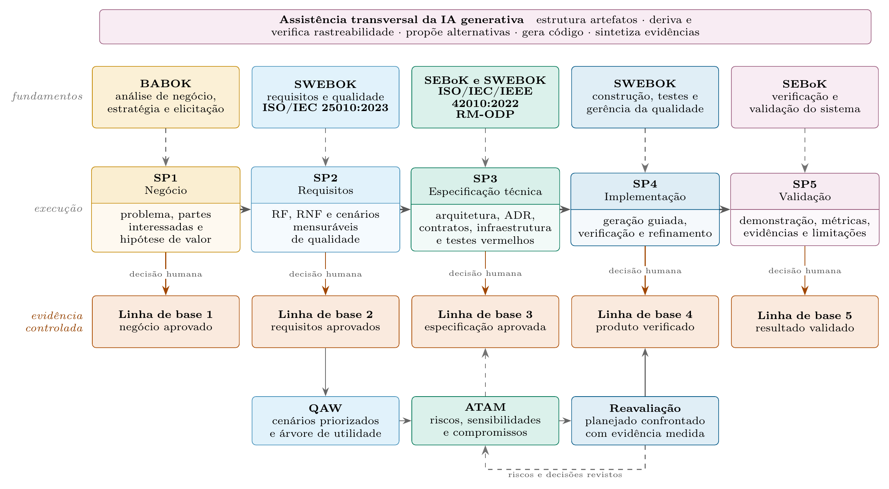

# DAIA-E

> [Versão em português](README.pt-BR.md). This English file is the canonical version.

**Specification-Driven, AI-Assisted Development.**
(Portuguese: *Desenvolvimento Assistido por Inteligência Artificial Orientado por Especificação.*)

DAIA-E is a validator of architecture descriptions and a guided process to build
software with AI assistants. DAIA-E moves the project from the business to the
validation. The CLI verifies each artifact, reference, test and evidence. Each
step closes only with a recorded human decision.

The kernel does not call language models. The agents and the skills guide the
host assistant (Claude, Codex or another assistant). The CLI verifies the result.

## The method



*The flow of the DAIA-E method (labels in Portuguese). The dashed arrows show
the methodological support.*

The development has five sprints. Each sprint sets a **scope, not a
duration**. Each sprint uses a body of knowledge and ends with a **baseline**:
the approved state of the project at that point. Only a recorded human decision
closes a baseline. The next sprint starts only after that decision.

| Sprint | Foundation | What it produces | Baseline |
|---|---|---|---|
| SP1 — Business | BABOK | business situation, stakeholders, business drivers and value hypothesis, with personas, BPMN processes and IDEF0 | 1 — business approved |
| SP2 — Requirements | SWEBOK and ISO/IEC 25010:2023 | functional requirements (FR), non-functional requirements (NFR) and measurable quality scenarios | 2 — requirements approved |
| SP3 — Technical specification | SEBoK, SWEBOK, ISO/IEC/IEEE 42010:2022 and RM-ODP | architecture, decisions (ADR), contracts, infrastructure and red tests | 3 — specification approved |
| SP4 — Implementation | SWEBOK | guided generation, verification and refinement until the tests are green | 4 — product verified |
| SP5 — Validation | SEBoK | demonstration, metrics, evidence and limitations | 5 — result validated |

Requirement ids use the prefixes `FR-` (functional) and `NFR-`
(non-functional). The kernel still accepts the old prefixes `RF-` and `RNF-` as
deprecated aliases. Use `FR-` and `NFR-` in new artifacts.

The architecture evaluation goes through the sprints in a cycle. After
baseline 2, the **QAW** puts the quality scenarios in order of priority in a
utility tree. Before baseline 3, the **ATAM** examines risks, sensitivities and
trade-offs. During the implementation, the **re-evaluation** compares the plan
with the measured evidence before baseline 4. It sends the revised risks and
decisions back to the ATAM.

Generative AI helps in **all** the sprints. It structures artifacts, derives
and verifies traceability, proposes alternatives, generates code and
summarizes evidence. The decisions stay deliberate because a human decides at
the close of each baseline, not because the AI is limited to one step.

In the CLI, `daia baseline sign` records the baseline. It records who decided,
when, with which rationale and on which state of the model. The state of the
model is a hash of the content of all the artifacts.

The CLI enforces these principles (see the [constitution](.daia-core/constitution.md)
for the details):

- **Human decision** (Art. II): agents write all drafts, but no baseline closes without a recorded approval.
- **Baseline order** (Art. III): no part of a sprint is produced before the previous sprint closes.
- **Traceability** (Art. IV): each artifact derives from an earlier artifact. An invention is detectable.
- **Quality as a scenario** (Art. V): each non-functional requirement has a measure and a test.
- **Architecture description** (Art. VII): views that follow ISO/IEC/IEEE 42010:2022.
- **Specification before generation** (Art. VIII): no product code before SP3.
- **Recorded alternative** (Art. IX): each relevant decision records the rejected option and the reason.
- **Bodies of knowledge** (Art. X): BABOK, SWEBOK and SEBoK are the foundation of each sprint.

## Writing standard

The DAIA-E text is in English and follows ASD-STE100 Simplified Technical
English. The CLI messages, the agents, the skills and this README use this
standard. Read [`docs/ste/README.md`](docs/ste/README.md) for the rules and
[`docs/ste/technical-names.json`](docs/ste/technical-names.json) for the
technical names. A Portuguese translation of this README is in
[README.pt-BR.md](README.pt-BR.md).

## Get started

You must have Node.js 18 or later. There are no external dependencies, and you
do not have to clone the repository.

```bash
npx github:afonsolelis/daia-e-core init meu-projeto
cd meu-projeto
npx github:afonsolelis/daia-e-core next
```

To use only `daia` in the commands, install it one time:

```bash
npm install -g github:afonsolelis/daia-e-core
daia init meu-projeto
```

We recommend the installation, because the AI assistant also runs `daia next`,
`daia gate` and `daia verify` in the project. The rest of this README uses
`daia`. If you do not install it, use `npx github:afonsolelis/daia-e-core`.

In an interactive terminal, the onboarding asks for the name, the type of
project (new or existing), the objective, the stack, the constraints and the
runtime. For automation, give all the values as flags:

```bash
daia init meu-projeto --yes --mode new --runtime codex \
  --name "My project" --objective "Objective of the system" \
  --stack "to be defined" --constraints "to be defined" --catalog rm-odp
daia next --root meu-projeto
```

| Flag | Values | Default |
|---|---|---|
| `--mode` | `new`, `existing` | `new` |
| `--runtime` | `codex`, `claude`, `portable` | `codex` |
| `--catalog` | `rm-odp`, `4plus1`, `c4` | `rm-odp` |

The `init` command creates `.daia/` in the project. This directory contains the
configuration, the guide, the schemas, the model, the workflow history, the
reference agents and the skills for the selected runtime. The other commands
operate on the current directory or on the directory in `--root`.

## Tutorial: from zero to a signed SP1

This tutorial models a loan system for a school library, from `init` to the
first baseline. The final result of this tutorial is in `examples/first-project/`.

### 1. Create the project

Install the CLI. Then create the project and show the first step:

```bash
npm install -g github:afonsolelis/daia-e-core
daia init biblioteca --yes --runtime claude \
  --name "School library" \
  --objective "Reduce the late returns of books"
cd biblioteca
daia next
```

The model is empty. Thus `daia next` shows SP1 and the initial blocking findings:

```text
SP1 — Context, personas and processes
-------------------------------------
State: in-progress
Skills: model-business-context, model-business-processes, validate-business-layer
Inputs: objective, stakeholders, constraints
Outputs: BusinessDriver, Stakeholder, Concern, Persona, BusinessProcess (BPMN), Idef0Activity
Verification: daia gate SP1

x SP1-FOUNDATION (Art. X)
   SP1 no business driver is declared
   SP1 no stakeholder is declared
   BABOK: declare why the system must exist and for whom.

x BIZ-PERSONA (Art. X)
   SP1 no persona is declared
   BABOK §10.43: declare the personas. Model each process from the persona that does it.
```

### 2. Ask the assistant for the artifacts

1. Open the assistant in the project directory: `claude` for Claude Code, `codex` for Codex.
2. Describe the business situation to the assistant.

This is a request that works:

> Run `daia next --json`. Read `.daia/guide.md` and `.daia/agents/analyst.md`.
> Use the skill `model-business-context`, then the skill `model-business-processes`.
> The situation: the school library records loans in a notebook, and about 30% of
> the books come back late. The late returns affect the librarian, who serves
> about 40 students each day. They also affect the coordination, which is
> responsible for the collection. If you do not know something, ask. Do not
> invent it. At the end, run `daia gate SP1`.

In Claude Code, you can also call the skills by name, for example
`/model-business-context`. The assistant writes one JSON file for each artifact
in `.daia/model/`. This is an example of a business driver:

```json
{
  "id": "BD-return",
  "kind": "BusinessDriver",
  "statement": "Decrease the late returns of the school library books",
  "rationale": "The check of the last semester showed that about 30% of the loans came back after the due date",
  "stakeholders": ["STK-librarian", "STK-coordination"],
  "idef0_node": "A0",
  "hypothesis": "If the loan records the due date and the student gets a notice before that date, late returns decrease to less than 10%",
  "sprint": "SP1",
  "provenance": { "drafted_by": "ai-assisted" }
}
```

The minimum set for SP1 has eight artifacts and one BPMN file. The artifacts
are two stakeholders, one concern, one business driver with a hypothesis, one
persona with evidence, the IDEF0 activity `A0`, one process and the enterprise
view. The BPMN file is `docs/lend-book.bpmn`. To see all of them without the
assistant, run:

```bash
npx degit afonsolelis/daia-e-core/examples/first-project/.daia/model .daia/model --force
npx degit afonsolelis/daia-e-core/examples/first-project/docs docs
```

### 3. Pass the gate

Run the gate for SP1:

```bash
daia gate SP1
```

Each blocking finding tells what is absent and which rule applies. A frequent
error: the BPMN lane must have the exact name of the persona.

```text
x BIZ-BPMN (Art. X)
   BP-lend-book persona "Librarian" has no lane in the BPMN model
   Give the lane or the participant the name of the persona.
```

When all the rules pass, the gate shows the sign command:

```text
PASSED — the gate does not close the baseline. Art. II: only a human signs it. Run:
  daia baseline sign SP1 --by "<name>" --rationale "<rationale>"
```

Run `daia verify SP1` to record the verification. Then `daia status` shows that
SP1 is ready to sign.

### 4. Approve the baseline

You sign the baseline, not the assistant. Review the artifacts. If you agree,
run:

```bash
daia baseline sign SP1 --by "Your name" --rationale "Business model reviewed with the librarian"
```

SP1 is now signed. `daia next` goes to SP2 and shows the first blocking
finding: the activity `IDF-A0` is in the boundary but has no functional
requirement (rule `ELI-ACTIVITY-COVERAGE`).

If you change an SP1 artifact after the signature, `daia status` shows that the
baseline needs a review. If you undo the change, the signed state comes back.
If you keep the change, you must approve the baseline again.

### 5. Do the next sprints

Each sprint uses the same cycle:

1. Run `daia next`.
2. Give the request to the assistant.
3. Run `daia gate`.
4. Run `daia verify`.
5. Sign the baseline.

| Sprint | Ask the assistant | The gate examines |
|---|---|---|
| SP2 | "Follow `@po` and the skills `elicit-requirements-from-business` and `specify-quality-scenarios`." | a requirement (`FR-*`) for each activity in the boundary, quality scenarios with a real measure |
| SP3 | "Follow `@arch`, then `@test`. Evaluate the tactics with `@atam`." | static and dynamic models, views, decisions with an alternative, red test contracts |
| SP4 | "Follow `@dev` and implement the signed specification." | green contracts with current evidence and `quality-report.md` |
| SP5 | "Follow `@val` and compare the result with the hypothesis." | `validation.md` with the script, the results and the limitations |

From SP3, set the command for each test contract in `.daia/config.json` (see
[Executable evidence](#executable-evidence)).

## Workflow

Do these steps for each sprint:

1. Run `daia next`. It shows the current step, the inputs, the deliverables, the skills and the blocking findings.
2. The assistant writes the artifacts in `.daia/model/`. It follows `.daia/guide.md` and the schemas in `.daia/schemas/`.
3. Run `daia gate SP<n>`. It examines the rules and does not run project commands.
4. Run `daia verify SP<n>`. It runs the configured tests and records the progress in `.daia/workflow.json`.
5. The human approves: `daia baseline sign SP<n> --by "Name" --rationale "Rationale"`.

| Sprint | Agents | Skills |
|---|---|---|
| SP1 | `@analyst`, `@pm`, `@ux-design-expert`, `@val-biz` | model-business-context, model-business-processes, validate-business-layer |
| SP2 | `@po`, `@pm`, `@qaw`, `@ux-design-expert`, `@val-req` | elicit-requirements-from-business, specify-quality-scenarios, prioritize-architecture-drivers, validate-requirements-layer |
| SP3 | `@arch`, `@data-engineer`, `@atam`, `@spec`, `@test`, `@qa`, `@val-eng`, `@val-tec` | describe-software-architecture, validate-engineering-layer, validate-technology-layer, evaluate-architecture-tradeoffs, write-executable-specification and the seven tactic skills (below) |
| SP4 | `@dev`, `@data-engineer`, `@qa`, `@audit`, `@devops` | implement-from-baseline, validate-system-evidence |
| SP5 | `@val`, `@devops`, `@qa` | validate-system-evidence |

Some agents work in all the sprints. `@rec` controls the close of the
baselines. `@sm` removes impediments. `@daia-master` routes requests and
corrects the course. `@squad-creator` creates agents and skills.

**Architecture tactics.** In SP3 and in the SP4 re-evaluation, `@atam`
evaluates the decisions against the tactics of Bass, Clements and Kazman
(*Software Architecture in Practice*, 3rd ed., ch. 5–11). There is one skill
for each attribute: `evaluate-availability-tactics`,
`evaluate-interoperability-tactics`, `evaluate-modifiability-tactics`,
`evaluate-performance-tactics`, `evaluate-security-tactics`,
`evaluate-testability-tactics` and `evaluate-usability-tactics`. The applied
tactics are in the `tactics` field of each decision, for example
`availability/active-redundancy`.

**Layer validators.** Each layer gets a review report before the next layer:
`@val-biz` (business, BABOK), `@val-req` (elicitation, SWEBOK + SEBoK),
`@val-eng` (engineering, SEBoK + RM-ODP) and `@val-tec` (technology). The
related mechanical rules show in the gate with the prefixes `BIZ-`, `ELI-`,
`ENG-` and `TEC-`. The agent `@val-biz` replaces the old agent `@val-neg`.

### Existing software

Use `--mode existing`. Start with an inventory of the code and the tests in
`.daia/evidence/recovery.md`, with the origin and the limitations. A recovered
view must have a declared confirmation after a human review. Tests that exist
before SP3 can stay green in SP3.

## Commands

| Command | What it does |
|---|---|
| `init [dir]` | Runs the onboarding and creates `.daia/` |
| `next [--json]` | Shows the current step, inputs, deliverables, skills and blocking findings |
| `gate [SP1..SP5] [--json] [--quiet]` | Evaluates the rules. Exits with a non-zero code if a finding blocks |
| `verify [SP1..SP5]` | Runs the configured tests and records the progress |
| `validate architecture` | Runs the SP3 gate, with the evidence and the prerequisites |
| `status` | Shows the state of the five sprints and of the baselines, current or out of date |
| `baseline list` | Lists the baselines and verifies the signatures |
| `baseline sign <SP> --by <name> --rationale <reason> [--debt "a;b"] [--force]` | Closes the baseline with a recorded human decision |
| `trace <id> [--up]` | Shows the traceability chain from an artifact |
| `trace --matrix` | Shows the matrix requirement → scenario → test |
| `impact <id>` | Shows what a change to the artifact affects |
| `viewpoints [--catalogs]` | Shows the active viewpoint catalog, or the available catalogs |
| `rules` | Shows the correspondence rules and the articles that support them |
| `squad` | Lists the agents and verifies the portability contract |
| `skills` | Lists the skills |
| `skills sync [id] --to <runtime>` | Installs one skill or all the skills in the runtime |
| `setup --to <runtime>` | Installs the agents and the skills in the project runtime |
| `doctor` | Examines the environment and the model |

## Agents

The squad has 23 agents in `squads/daia-e/agents/`. Each agent has a sprint,
views, a body of knowledge, an explicit boundary and skills. You can paste any
agent in a chat. It does not depend on a runtime (Art. XI).

Each of the 12 aiox-core agents has a related DAIA-E agent, adapted to the
DAIA-E constitution. The map is in `lineage`, in `squad.json`:

| aiox-core | DAIA-E | Main adaptation |
|---|---|---|
| `@aiox-master` | `@daia-master` | routes by sprint and corrects the course; does not do specialized work |
| `@analyst` | `@analyst` | research and brainstorm sessions give input to SP1 |
| `@architect` | `@arch` | decisions in ISO 42010 views, with a recorded alternative |
| `@data-engineer` | `@data-engineer` | details the information view; `@arch` selects the database technology |
| `@dev` | `@dev` | implements the signed SP3 specification, not stories |
| `@devops` | `@devops` | has no exclusive authority: the human confirms each irreversible operation |
| `@pm` | `@pm` | vision, scope and MoSCoW priority, without PRD or epics |
| `@po` | `@po` | requirements engineering; the human decides the `priority` |
| `@qa` | `@qa` | advisory review report; a waiver becomes a debt that the human accepts |
| `@sm` | `@sm` | helps between baselines, without a fixed deadline or a backlog |
| `@squad-creator` | `@squad-creator` | creates agents and skills with the DAIA-E contracts |
| `@ux-design-expert` | `@ux-design-expert` | research, interaction and WCAG AA, linked to the personas |

The other agents are specific to the method: `@qaw`, `@atam`, `@spec`, `@test`,
`@audit`, `@val`, `@rec` and the four layer validators.

## What is validated

- Schemas and references between artifact types.
- Coverage of concerns by views, static and dynamic models, and recorded alternatives.
- Existence of the referenced documents and tests. The CLI refuses references outside the project.
- Declared correspondences with a source, a target and a rationale.
- Recorded test runs and fingerprints of the declared files.
- Baseline order and changes to documents, tests and the declared implementation.

The result is a structural validation and an evidence validation, **not an ISO
certification**. A human review is necessary for the semantic coherence of the
diagrams, the fitness of the decisions, the trade-offs and the meaning of the
measures. Architecture tests, recorded as contracts, can verify code constraints.

## Executable evidence

In `.daia/config.json`, set the verification for each contract:

```json
{
  "verification": {
    "TC-example": {
      "command": "node",
      "args": ["--test", "tests/example.test.js"],
      "inputs": ["src/example.js", "package.json"]
    }
  }
}
```

`daia verify SP3` runs the configured commands without a shell, with a timeout
of 60 seconds for each contract. It records the output, the exit code and the
fingerprint. The fingerprint always includes the test and the model. Declare
all the other relevant files in `inputs`. The fingerprint does not cover
external services, environment variables and omitted files. Run only commands
from projects that you trust.

The gate does not accept only `phase: green`. It must have compatible and
current evidence. If a test fails in red, examine the failure. A failure can
show behavior that is not implemented yet or a defect in the test. The system
does not change `phase` automatically.

SP4 must have `quality-report.md`. SP5 must also have `validation.md`. Both
files are in `.daia/evidence/` and contain the results and the limitations.
The CLI verifies that the reports exist. The quality of the conclusions depends
on the review.

## Approvals and changes

The baseline records the name, the rationale, the date and the hash of the
model state. It is a **declared local approval**. It is not an identity
authentication and it is not a cryptographic signature. Agents record it only
after an explicit authorization from the person.

A change to a referenced artifact makes the related baseline invalid. Then
`daia status` shows that the baseline needs a review. In SP4 and SP5, the
calculation also includes the implementation files in `inputs` and the reports.
Some baselines were signed before the calculation included the file content.
These baselines also show that they need a review, and you must review them.

`--debt` records an acceptance with debt. With `--force`, you can sign while a
blocking finding is open. But `--force` does not change absent evidence into
proof. The workflow continues to show the open blocking findings.

## Runtimes

```bash
daia setup --to codex
daia setup --to claude
daia setup --to portable
daia skills sync describe-software-architecture --to codex
```

| Runtime | Skill destination | Documentation |
|---|---|---|
| `claude` | `.claude/skills/` | [Claude Code](https://code.claude.com/docs/en/skills) |
| `codex` | `.agents/skills/` | [Codex](https://learn.chatgpt.com/docs/build-skills) |
| `portable` | `.daia/export/skills/` | manual integration in other hosts |

The setup installs the 23 agents as reference material in `.daia/agents/`. The
runtime does not register them as native subagents. We do not promise automatic
activation in hosts that we did not test.

The installation validates the library before it writes files. It is
idempotent, and it refuses conflicts with different content. Keep or move your
customizations before you install again. The installation does not delete old
projections in `.codex/skills/` automatically. Review them to prevent duplicates.

## Examples

`examples/first-project/` is the result of the tutorial: the complete SP1 of
the school library, without a signed baseline. A test makes sure that the
example continues to pass `gate SP1`.

```bash
npx degit afonsolelis/daia-e-core/examples/first-project first-project
daia gate SP1 --root first-project
```

`examples/pblrepositorymetrics/` contains a complete model of the five sprints,
with 37 artifacts. Examine it with these commands:

```bash
npx degit afonsolelis/daia-e-core/examples/pblrepositorymetrics pblrepositorymetrics
daia status --root pblrepositorymetrics
daia trace --matrix --root pblrepositorymetrics
```

The baselines of this example were signed before the fingerprint calculation
included the file content. Thus they show that they need a review.

## References

`docs/references/README.md` maps each layer to the sections of the bodies of
knowledge and to the gate rules. The local copies of BABOK v3, SWEBOK v4,
SEBoK v2.14 and the summary of the Bass, Clements and Kazman tactics are in
`docs/references/bok/`. They are not in version control, because the licenses
do not let us redistribute them. To reproduce the environment, get each work
from its official source.

## Structure and development

To contribute to the library, clone the repository:

```bash
git clone https://github.com/afonsolelis/daia-e-core.git
cd daia-e-core
node bin/daia.js help
```

```text
bin/daia.js          CLI and onboarding
kernel/              schemas, rules, gates, baselines, traceability, verification and workflow
squads/daia-e/       agents, skills, guide and canonical contracts
tests/kernel/        unit tests and a complete SP1–SP5 run
examples/            the tutorial project and a complete model of the five sprints
docs/references/     map of the bodies of knowledge
docs/ste/            writing standard (STE) and list of technical names
docs/legacy/         archived AIOX rules, without automatic activation
scripts/check.js     syntax check
.daia-core/          DAIA-E constitution
```

```bash
npm run check       # syntax of all the JavaScript files in bin, kernel, scripts and tests
npm test            # tests, with onboarding, evidence, resume and squad contracts
npm run pack:check  # content of the npm package
```

This JavaScript library has no compilation step and no static type check. To
change agents or skills, edit only `squads/daia-e/`. Follow
`AGENT-CONTRACT.md` and `SKILL-CONTRACT.md`. The tests refuse changes that do
not obey the contracts. Write new text with the standard in
[`docs/ste/README.md`](docs/ste/README.md).

## License and lineage

MIT. DAIA-E derives from [Synkra AIOX](https://github.com/SynkraAI/aiox-core),
which derives from the BMad Method. See [ATTRIBUTION.md](ATTRIBUTION.md) and the
[constitution](.daia-core/constitution.md). DAIA-E has no affiliation with the
source projects.

Method adapted from: Brandão, A. C. L., Arakaki, R. & Silva, L. A. (2026).
*An RM-ODP Method to Model PBL Digital Twins for Supporting Closed-Loop
Supervision.* MethodsX (in press).
